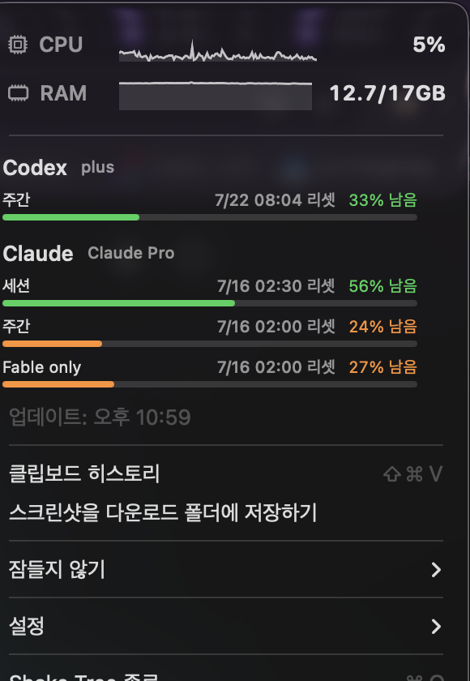

# Shake Tree 🌳

RunCat + CodexBar + Maccy + Amphetamine을 하나로 합친 개인용 macOS 메뉴바 앱입니다.
메뉴바에 상태 아이콘 여러 개가 늘어서는 게 싫어서, 자주 쓰던 기능들을 나무 아이콘 하나로
모았습니다. CPU 사용률이 높을수록 나무가 바람에 세게 흔들립니다 (산들바람 → 태풍).

> A personal all-in-one macOS menu bar app that merges RunCat + CodexBar + Maccy +
> Amphetamine into a single icon. Built because having four separate menu bar icons felt
> cluttered. The tree sways harder as CPU usage rises (light breeze → typhoon).

<p align="center">
  
</p>

## 기능 (Features)

| 기능 | 설명 |
|---|---|
| 🌳 흔들리는 나무 | CPU 사용률 = 바람 세기. 절전 기본 5초(패널 열림 2초) 간격 샘플링 + 제곱근 곡선이라 저·중간 CPU 구간에서도 변화가 잘 느껴짐. 평소엔 흑백(라이트/다크 메뉴바 자동 대응)이지만 CPU 95%↑ 또는 심각한 메모리 압박이면 빨강, CPU 80%↑ 또는 메모리 압박 경고이면 주황으로 아이콘 자체가 물듦 |
| 📊 CPU·RAM·저장공간 | CPU·RAM 추이와 저장 점유량을 표시. 저장은 파일·시스템과 스왑 파일을 분리하며, 스왑의 현재 사용량과 확보 용량도 따로 표시. 정리 가능 공간은 파일·시스템에 포함되어 중복 계산하지 않음 |
| 🤖 Codex·Claude 사용량 | 세션/주간 "남은 %" 게이지 + 리셋 시각. 번들된 CLI로 조회 — **CodexBar 앱 설치 불필요** |
| 📋 클립보드 히스토리 | 텍스트·이미지·파일 지원, 검색, 핀 고정, **⇧⌘V**로 메뉴바 아래 드롭다운. 비밀번호 매니저가 복사한 항목은 기록 안 함 |
| ☕ 잠들지 않기 | 우클릭으로 즉시 토글. 무기한·30분·1/2/4시간 또는 1~1440분 직접 지정. 덮개가 열려 있을 때의 화면 유지와 덮개를 닫은 뒤의 실행 유지를 각각 설정 |
| 📸 스크린샷 | 두 가지 모드 — **다운로드+클립보드**(파일 저장 + 클립보드 자동 복사) 또는 **클립보드만**(파일 없이 바로 복사). 두 모드 다 캡처 후 뜨는 '미리보기 썸네일'을 꺼서 즉시 반영(썸네일이 켜져 있으면 파일 쓰기가 몇 초 늦어져 복사도 지연됨) |

<details>
<summary><b>English</b></summary>

| Feature | Description |
|---|---|
| 🌳 Swaying tree | CPU usage = wind strength. Sampled every 5s by default (2s with the panel open), with a square-root response curve so changes are noticeable even in the low/mid CPU range. Monochrome by default (auto light/dark), turns red for CPU ≥95% or critical memory pressure, orange for CPU ≥80% or a memory pressure warning |
| 📊 CPU/RAM/Disk | CPU/RAM trends and physical disk occupancy. File/system storage and allocated swap files are separated; used swap pages and allocated swap capacity are shown independently. Purgeable space remains within file/system occupancy |
| 🤖 Codex/Claude usage | Session/weekly "remaining %" gauges with reset time, fetched via a bundled CLI — **no CodexBar.app install required** |
| 📋 Clipboard history | Text/image/file support, search, pinning, **⇧⌘V** dropdown anchored under the menu bar icon. Password-manager copies are never recorded |
| ☕ Keep awake | Right-click to toggle. Indefinite, 30 minutes, 1/2/4 hours, or a custom 1–1440 minutes. Choose system-only idle-sleep prevention (display may sleep) or keeping the display awake too. Native OS timeout releases timed sessions |
| 📸 Screenshots | Two modes — **Download + clipboard** (save a file and copy to the clipboard) or **clipboard only** (no file, copied directly). Both turn off the floating preview thumbnail so it lands instantly (the thumbnail otherwise delays the file write, and thus the copy, by several seconds) |

</details>

## 빌드 / 설치 (Build & Install)

```sh
scripts/install.sh    # release 빌드 → "/Applications/Shake Tree.app" 설치 + 실행
scripts/build-app.sh  # 검색에 표시되지 않는 .build/ShakeTreeBuild.noindex에 앱 빌드
scripts/build-icon.sh # 앱 아이콘(Resources/AppIcon.icns) 재생성 — 디자인 바꿀 때만 실행
swift build           # 개발용 빌드
```

빌드·설치 중 생성한 앱은 `.noindex` 작업 폴더에 두므로 macOS 앱 검색에 중복으로 나타나지
않습니다. 설치가 정상 완료되면 기본 빌드 사본도 정리합니다. `SHAKETREE_APP_OUTPUT`으로 빌드
경로를 직접 지정할 때도 `.noindex` 폴더 안의 `.app` 경로를 사용하세요.

의존성은 Xcode 커맨드라인 툴체인뿐입니다. **다른 앱을 따로 설치할 필요가 없습니다** — Codex/Claude
사용량 조회에 쓰는 CLI(`vendor/codexbar-cli`, [steipete/CodexBar](https://github.com/steipete/CodexBar)
에서 추출한 것)를 앱 번들 안에 함께 넣어뒀습니다. Codex는 `~/.codex/auth.json`, Claude는 브라우저
쿠키에서 직접 읽습니다.

> **주의**: 번들된 `codexbar-cli`는 재서명하지 않습니다. 원본 서명을 유지해야 키체인(Chrome Safe
> Storage 등) 접근 권한이 살아있어 Claude 사용량을 읽을 수 있기 때문입니다. `build-app.sh`는 우리
> 실행 파일과 앱 번들만 ad-hoc 서명하고, 벤더 CLI는 건드리지 않습니다.

<details>
<summary><b>English</b></summary>

Only dependency is the Xcode command-line toolchain. **No other app needs to be
installed** — the CLI used for Codex/Claude usage lookups (`vendor/codexbar-cli`,
extracted from [steipete/CodexBar](https://github.com/steipete/CodexBar)) is bundled
inside the app itself. Codex reads from `~/.codex/auth.json`; Claude reads from browser
cookies directly.

> **Note**: the bundled `codexbar-cli` is intentionally left un-re-signed. Its original
> signature must be preserved for Keychain access (e.g. Chrome Safe Storage) to keep
> working, which is required to read Claude usage. `build-app.sh` only ad-hoc signs our
> own executable and the app bundle, not the vendored CLI.

</details>

## 사용법 (Usage)

- **⇧⌘V** — 클립보드 히스토리 드롭다운 (↑↓ 이동, ⏎ 붙여넣기, ⌘1–9 바로 선택, 우클릭 핀/삭제, esc 닫기)
- 메뉴바 나무 **좌클릭** — 짧은 요약 패널: CPU/RAM/저장, 서비스별 AI 남은 한도, 잠들지 않기, 클립보드. 바깥 클릭이나 esc로 닫힘. 시스템 요약·AI 서비스 행을 누르면 별도 상세 창이 열림
- 메뉴바 나무 **우클릭**(또는 control-클릭) — 잠들지 않기 즉시 토글
- **설정… → 일반 → 스크린샷** — 파일+클립보드 / 클립보드만 중 선택 (선택 시 미리보기 썸네일이 꺼지고, 다시 켜려면 스크린샷 도구 옵션에서 '떠다니는 축소판 보기')
- **설정…** — 별도 창의 일반 / 자원 사용 / 잠들지 않기 탭. 로그인 시 자동 실행, 자동 붙여넣기(접근성 권한 필요), 기록 비우기·종료, 절전·기능별 수집, 잠자기 방지 시간·화면·세션 정책을 설정

## 권한 (Permissions)

- **다운로드/데스크탑 폴더 접근**: 스크린샷 감지에 필요 (최초 1회 macOS가 물어봄)
- **손쉬운 사용(Accessibility)**: "자동 붙여넣기"를 켤 때만 필요 (기본값은 복사만 하고 붙여넣기는 사용자가 직접)

## 스크립팅 트리거 (Scripting hooks)

디버깅/자동화용으로 실행 중인 앱에 분산 알림(distributed notification)을 보낼 수 있습니다.

```sh
SHAKETREE_POST=show-panel   "/Applications/Shake Tree.app/Contents/MacOS/ShakeTree"  # 클립보드 히스토리 열기
SHAKETREE_POST=show-menu    "/Applications/Shake Tree.app/Contents/MacOS/ShakeTree"  # 상태 메뉴 열기
SHAKETREE_POST=toggle-awake "/Applications/Shake Tree.app/Contents/MacOS/ShakeTree"  # 잠들지 않기 토글

SHAKETREE_DUMP=/tmp/frames          "/Applications/Shake Tree.app/Contents/MacOS/ShakeTree" # 흔들림 사이클 PNG 덤프
SHAKETREE_DUMP_WARNING=/tmp/warn    "/Applications/Shake Tree.app/Contents/MacOS/ShakeTree" # 경고색 미리보기 PNG
SHAKETREE_APPICON=/tmp/icon1024.png "/Applications/Shake Tree.app/Contents/MacOS/ShakeTree" # 앱 아이콘 소스 PNG 렌더
```

## 데이터 (Data)

AI 사용량은 서비스별 조회 시각·계정·출처·리셋 원본 시각을 `usage-cache-v2.json`에
저장합니다. Antigravity는 Gemini CLI와 별도로 표시하며 Gemini, 외부 모델 공유 한도 및 별도 모델
한도를 보존합니다. 조회 실패는 카드별로 표시하고, 1시간 이상 지난 값이나 리셋을 지난
값은 수치 대신 재조회를 안내합니다. 예전 `usage-cache.json`은 보존하되 읽지 않습니다.
개인 계정의 Gemini CLI OAuth 지원이 종료된 경우 해당 카드에서 Antigravity를 안내합니다.

사용량 조회기는 공식 CodexBar 0.82.0 릴리스의 서명된 실행 파일입니다.
버전·원본·SHA256은 `vendor/CODEXBAR_VERSION.json`에 고정하며 빌드할 때 확인합니다.
현재 `agy` 실행 파일은 `~/.gemini/bin/agy` 또는 설치된 Homebrew 경로에서 찾고,
명시적인 `ANTIGRAVITY_CLI_PATH` 설정이 있으면 그대로 따릅니다.

클립보드 히스토리는 로컬 SQLite에만 저장되고 외부로 전송되지 않습니다:
`~/Library/Application Support/ShakeTree/clipboard.sqlite` (최대 500개 + 핀 고정 항목)

## 참고한 오픈소스 (Credits)

- [steipete/CodexBar](https://github.com/steipete/CodexBar) (MIT) — 사용량 조회 CLI를
  `vendor/codexbar-cli`로 번들해서 그대로 사용. 라이선스 전문은
  [`vendor/CODEXBAR_LICENSE.txt`](vendor/CODEXBAR_LICENSE.txt), 고지는
  [`THIRD_PARTY_NOTICES.md`](THIRD_PARTY_NOTICES.md) 참고
- [p0deje/Maccy](https://github.com/p0deje/Maccy) (MIT) — 클립보드 감시 방식(폴링 주기,
  `org.nspasteboard.*` 비공개 타입 처리)을 참고. 코드를 그대로 가져오지는 않음

## 라이선스 (License)

MIT — [`LICENSE`](LICENSE) 참고. 번들된 서드파티 구성 요소는
[`THIRD_PARTY_NOTICES.md`](THIRD_PARTY_NOTICES.md)에 별도 고지되어 있습니다.

---

<sub>저장소 루트 폴더명만 개발 초기 이름(`quakka`)이 히스토리상 남아 있고, 앱 이름·번들·프로세스는
모두 <b>Shake Tree</b> / <code>ShakeTree</code>입니다.</sub>

## 낮은 자원 사용 (0.3.0)

- 사용량 조회기는 최대 2개만 동시에 실행합니다. 패널이 닫혀 있으면 정기 조회를 하지 않고, 열 때 오래된 서비스만 갱신합니다. 오류 재시도에는 간격을 둡니다.
- CPU는 약 1초마다, 숨은 패널의 메모리는 5초마다 샘플링합니다. 디스크 조회는 백그라운드에서 캐시하며 화면 잠금·잠자기 중에는 시스템 샘플과 나무 애니메이션을 멈춥니다.
- 클립보드는 기존 0.5초 응답을 유지합니다. 나무는 앱이 프레임을 그리는 대신 Core Animation으로 최대 15fps로 움직입니다.
- 잠들지 않기는 화면을 기본으로 켜 둡니다. 덮개가 열려 있을 때 화면의 자동 꺼짐을 허용할 수도 있으며, 화면 보호기와 수동 잠금은 macOS 설정을 따릅니다.
- 덮개 닫힘 유지에는 macOS의 시스템 전체 `SleepDisabled` 설정이 필요합니다. 이 기능은 `sudo -n /usr/bin/pmset -a disablesleep 1`과 `0`에 대한 기존 권한이 있을 때만 켜집니다(예: Amphetamine Power Protect). 권한이 없으면 화면에 실패를 표시하며 다른 설정을 설치하거나 권한을 확대하지 않습니다.
- 덮개 닫힘 세션 동안에는 입력을 기다리는 작은 감시 프로세스 하나를 사용합니다. 종료·시간 만료·앱 중단 시 원래 꺼져 있던 설정을 복구하고, 재부팅으로 중단된 경우 로그인 시 복구합니다. 이미 다른 곳에서 켜 둔 설정은 해제하지 않습니다. 시스템 전체 값이므로 다른 앱이 세션 중 같은 값을 바꾸면 서로 영향을 줄 수 있습니다.

검증: `swift test --build-system native --disable-swift-testing` (기존 빌드 경로 재사용).

## 다음 날 갱신 화면 (0.3.1)

- 오래된 수치는 각 한도마다 경고하지 않고 카드 하나의 안내와 마지막 확인 시각으로 묶습니다. 이전 기록은 펼쳐볼 수 있으며 현재 수치로 표시하지 않습니다.
- 카드별 대기/조회 중 경과 시간과 전체 완료 개수를 표시합니다. 조회 중에는 취소할 수 있고, 완료 후 각 서비스만 다시 조회할 수 있습니다.
- 전체 조회는 최대 45초이며, 중단 뒤 늦게 돌아온 결과가 새 조회를 덮어쓰지 않습니다. 성공한 서비스는 즉시 캐시에 저장됩니다. 동시 실행 제한 2개와 닫힌 패널의 정기 조회 중단은 유지합니다.
- 지원이 종료된 개인용 Gemini CLI 카드는 Antigravity와 중복 표시하지 않습니다. 실제 Gemini CLI 조회가 다시 성공하면 카드가 돌아옵니다.

0.3.2부터 Antigravity의 기존 `Claude / GPT` 묶음은 **외부 모델 공유 한도**로 표시합니다.
이는 안티그래비티 안에서 Claude·GPT-OSS 등이 함께 쓰는 한도이며, 모델별 사용 이력이나
Claude Code·ChatGPT 구독 한도를 뜻하지 않습니다. 기존 캐시에도 새 표기가 즉시 적용됩니다.


## 자원 절감과 세션 관리 (0.4.0)

- 기본 절전 모드는 시스템 수집을 닫힌 패널 5초 / 열린 패널 2초로 조절합니다. 절전을 끄면 3초 / 1초이며, 배터리에서는 절전 주기를 유지합니다. OS 저전력 모드·높은 온도에서는 10초 / 5초로 더 줄이고 나무 애니메이션을 멈춥니다.
- 시스템 감시·나무 움직임·클립보드 기록·AI 조회를 각각 끌 수 있습니다. 클립보드는 켜져 있고 화면이 활성일 때만 0.5초 간격으로 확인합니다. 화면 잠금·꺼짐 동안 시스템 및 클립보드 타이머를 해제하고, 화면이 돌아오면 최신 클립보드 변경을 확인합니다.
- 시스템 수집은 별도 서비스가 담당하며 CPU·메모리 측정은 소유한 Mach host 포트를 재사용하고 해제합니다. 시스템 수치 변경은 시스템 화면만 갱신합니다.
- 조회기는 반복 확인 대신 출력·종료 이벤트와 단발 제한 시간으로 동작합니다. 패널을 닫으면 진행 중 조회도 취소하며, 동시에 실행하는 도우미는 최대 2개입니다.
- 메뉴바에는 작은 CPU·RAM 추이, 파일·스왑 저장 막대, 2열 AI 잔여량 카드, 잠들지 않기·클립보드를 표시합니다. 설정은 별도 창의 일반/자원 사용/잠들지 않기 탭으로 옮겼습니다. 시스템 요약이나 AI 서비스 행을 누르면 그래프·계정·모델별 한도·리셋 시각을 상세 창에서 확인합니다. AI 요약은 유효한 한도 중 가장 적게 남은 항목과 해당 모델·기간을 함께 표시하며, 합산 비율을 만들지 않습니다. 작은 화면에서는 패널을 스크롤할 수 있습니다.
- 잠자기 방지에는 화면 모드·남은 시간·덮개 닫힘 유지 상태가 표시됩니다. 배터리로 동작 중 20% 이하이면 자동 해제하고 재시작을 막으며(설정에서 변경 가능), 온도가 위험 수준일 때도 세션을 종료합니다. 덮개 닫힘 유지를 켜면 세션 동안 macOS의 시스템 전체 잠자기 설정이 적용됩니다.
- 정상 종료 시 세션을 해제합니다. 비정상 종료 후에는 24시간 안에 시작했고 아직 유효한 세션을 복원하며, 해당 복원도 설정에서 끌 수 있습니다. 설치 업데이트 중 기존 세션 보존은 계속 지원합니다.
